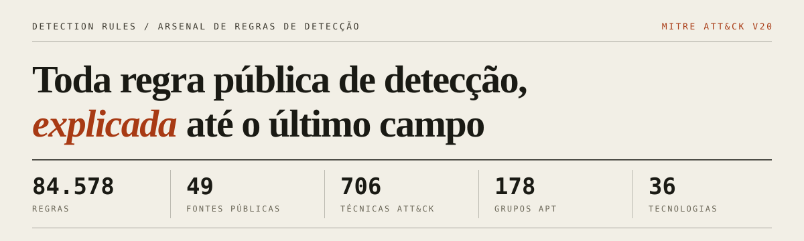
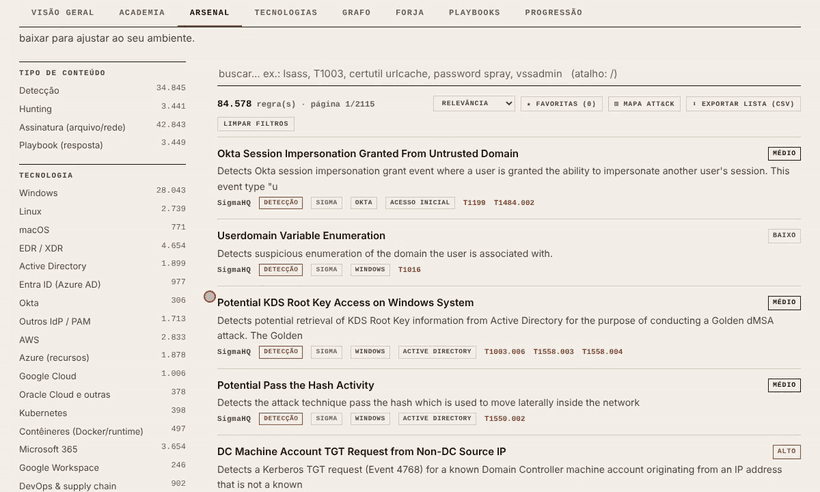
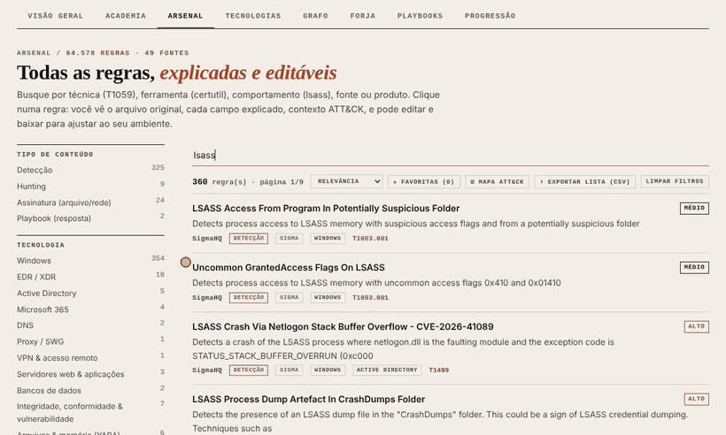
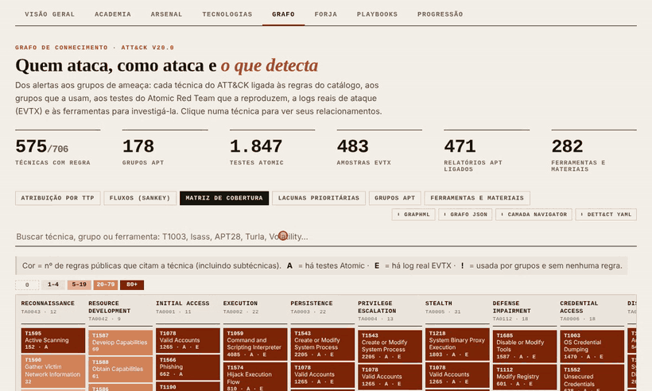
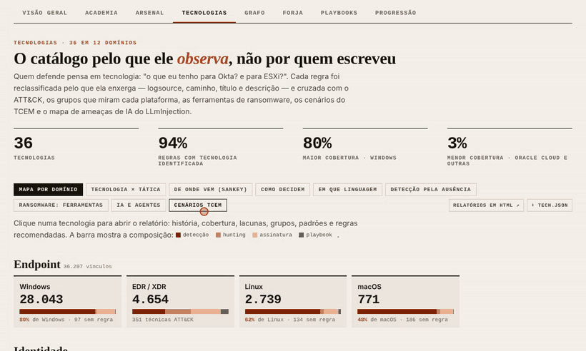
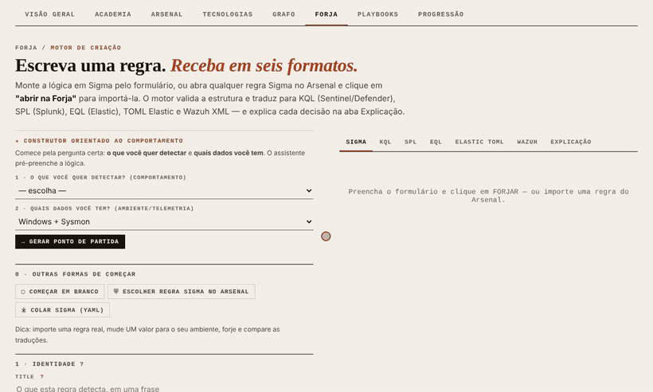
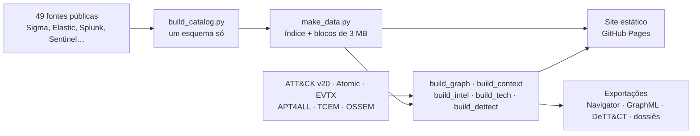

<div align="center">

<a href="https://ridd1kulusc0d3r.github.io/detectionrules/"></a>

<p>
<a href="https://ridd1kulusc0d3r.github.io/detectionrules/"></a>
<a href="https://github.com/Ridd1kulusC0d3r/detectionrules/actions/workflows/pages.yml"></a>


</p>

<p>
<a href="https://ridd1kulusc0d3r.github.io/detectionrules/"><b>Abrir o site</b></a> ·
<a href="COMECE-AQUI.md">Comece aqui</a> ·
<a href="#veja-funcionando">Veja funcionando</a> ·
<a href="#exportações">Exportações</a> ·
<a href="#rodar-localmente">Rodar localmente</a> ·
<a href="#fontes">Fontes</a>
</p>

</div>

84.578 regras reais de 49 fontes públicas (Sigma, Elastic, Splunk, Sentinel, Chronicle, OpenSearch, Wazuh, Suricata/Snort/Sagan, YARA, Falco, Panther, QRadar AQL e playbooks SOAR), normalizadas num só esquema. Cada regra responde quatro perguntas: **o que detecta, de quais dados depende, por que disparou e como provar que funciona.**

| Detecção | Assinaturas | Hunting | Playbooks SOAR |
|---:|---:|---:|---:|
| 34.845 | 42.843 | 3.441 | 3.449 |

<div align="center">
<a href="https://ridd1kulusc0d3r.github.io/detectionrules/"></a>
<br><sub>Do termo de busca à regra explicada: a ficha abre em 7 abas e a primeira conta a regra como uma história em 5 atos.</sub>
</div>

## Veja funcionando

<table>
<tr>
<td width="50%" valign="top">

<b>Prepare os dados e experimente</b><br>
<sub>O que o ATT&CK recomenda coletar, o evento e o comando que liga cada log, e a regra Sigma rodando contra eventos que devem e que não devem disparar.</sub>
</td>
<td width="50%" valign="top">

<b>Grafo e atribuição por TTP</b><br>
<sub>Cobertura das 706 técnicas, relacionamentos de cada uma e, a partir dos alertas que dispararam, os grupos mais compatíveis.</sub>
</td>
</tr>
<tr>
<td width="50%" valign="top">

<b>Tecnologias</b><br>
<sub>O catálogo reclassificado pelo que cada regra observa: 36 tecnologias, heatmap por tática e um relatório por plataforma.</sub>
</td>
<td width="50%" valign="top">

<b>Forja</b><br>
<sub>Você diz o comportamento e os dados que tem; sai a regra em Sigma, KQL, SPL, EQL, TOML Elastic e Wazuh, com cada decisão explicada.</sub>
</td>
</tr>
</table>

## O que o site faz

| Área | Para quê |
|---|---|
| **Arsenal** | Buscar e filtrar as 84.578 regras e abrir cada uma numa ficha de 7 abas |
| **Tecnologias** | Ver a cobertura pelo que a regra observa (Windows, Okta, AWS, Kubernetes, IA…) |
| **Grafo** | Cruzar regras com técnicas, grupos, testes Atomic, logs EVTX e mitigações |
| **Atribuição por TTP** | Sair dos alertas que dispararam para os grupos mais compatíveis |
| **Dossiês** | Ler um relatório de inteligência por grupo (178) e por tecnologia (36) |
| **Forja** | Criar uma regra e receber seis traduções |
| **Academia** | Aprender a ler regra em 8 lições |
| **Playbooks** | Separar resposta de detecção, com modelos de triagem |

<details>
<summary><b>Todos os recursos, em detalhe</b></summary>
<br>

- **Arsenal:** busca e filtros por tipo, **tecnologia**, **padrão de correlação**, fonte, formato, severidade, tática e técnica ATT&CK. Cada regra abre numa ficha com 7 abas: *Entenda · Veja a lógica · Prepare os dados · Experimente · Adapte · Investigue · Origem & versões*.
- **Cada regra contada como história (aba Entenda):** prólogo em uma frase com analogia de Feynman e a posição na cadeia do ataque; **Ato 1 · o palco** (tecnologia e lente TCEM), **Ato 2 · quem faz isso de verdade** (procedimentos reais do ATT&CK com o país atribuído pelo APT4ALL, ferramentas de ransomware citadas, ameaças de IA do LLmInjection), **Ato 3 · o rastro** (eventos e fontes de log), **Ato 4 · a armadilha** (padrão de correlação, o que procura e o que ignora, limiar e janela), **Ato 5 · onde ela tropeça** (falsos positivos e evasão) e **epílogo** (triagem e o próximo capítulo provável do ataque).
- **Tecnologias:** o catálogo reclassificado pelo que cada regra observa (36 tecnologias em 12 domínios: Windows, Okta, Entra ID, AWS, Kubernetes, ESXi, Microsoft 365, IA/LLMs…), com mapa por domínio, heatmap tecnologia × tática, Sankey fonte → domínio → tecnologia, padrões de correlação do TCEM, matriz de linguagens, **detecção pela ausência** (técnicas da plataforma sem regra), grupos que miram cada plataforma, Ransomware Tool Matrix × regras, ameaças de IA do LLmInjection e cenários de referência do TCEM. Um relatório por tecnologia no app e em [`reports/tech/`](reports/tech/index.html).
- **Experimente:** regras Sigma rodam numa simulação no navegador com eventos que devem e que não devem disparar, mostrando campo a campo por quê.
- **Adapte:** editor com validador por formato e download do **pacote de detecção** (regra + guia + casos de teste).
- **Forja:** você diz o comportamento e os dados que tem; o motor monta a regra e traduz para Sigma, KQL, SPL, EQL, TOML Elastic e Wazuh, explicando cada decisão.
- **Grafo de conhecimento (ATT&CK v20.0):** matriz de cobertura das 706 técnicas, lacunas prioritárias (técnicas usadas por muitos grupos e com poucas regras), 178 grupos APT com o percentual de técnicas que o catálogo público consegue ver, e um grafo de relacionamentos por técnica: grupos, subtécnicas, regras por formato, testes Atomic Red Team, logs EVTX reais, mitigações e softwares.
- **Atribuição por TTP:** monte um caso com os alertas que dispararam (pelo botão *+ caso* na ficha da regra, colando nomes do SIEM ou códigos de técnica) e veja os grupos mais compatíveis, ponderados pela raridade de cada técnica, num Sankey alertas → técnicas → grupos. Inclui as próximas caças para confirmar ou descartar a hipótese e exporta o relatório do caso em Markdown.
- **Dossiês de inteligência:** um por grupo (178), com perfil, origem atribuída, motivação, setores, vítimas e nomes por fornecedor (APT4ALL), ferramentas de intrusão (Ransomware Tool Matrix), cobertura por tecnologia, TTP e procedimentos por tática, assinatura comportamental, arsenal, campanhas, cobertura de detecção, regras recomendadas, plano de emulação, hipóteses de hunting, OSINT e bibliografia. No site e em [`reports/`](reports/README.md), prontos para compartilhar (TLP:CLEAR).
- **Fluxos (Sankey):** oferta de detecção (formato → tática) e demanda adversária (grupo → tática → com ou sem regra pública).
- **Ficha da regra enriquecida:** contexto ATT&CK na aba *Entenda*, fontes de log recomendadas pelo MITRE na aba *Prepare os dados* e testes Atomic + logs EVTX para provar a detecção na aba *Experimente*.
- **Ferramentas e materiais:** 282 itens da planilha *Malware IR – Tools & Resources*, organizados por fase do trabalho e ligados aos formatos de regra que cada fase produz.
- **Academia:** 8 lições pela técnica de Feynman e o dicionário de campos de cada formato.
- **Playbooks:** resposta separada de detecção, com 5 modelos de triagem e os playbooks reais do catálogo.
- **Progressão:** XP, ranks e conquistas, salvos no navegador.
- **[Manual de Threat Detection](docs/manual-threat-detection.html):** ataques, logs, forense, threat modeling e threat intelligence explicados do zero.

</details>

Estados de curadoria explícitos: **importada → explicada → simulada → adaptada**. Explicação e simulação são apoio de estudo; não equivalem a teste no mecanismo real.

## Como os dados chegam ao site



Tudo roda com a biblioteca padrão do Python e o site não tem servidor: o navegador baixa o índice e só o bloco da regra que você abre.

## Exportações
`build_graph.py` cruza o catálogo com o MITRE ATT&CK v20.0 (STIX oficial), 1.847 testes do Atomic Red Team (só metadados), 483 amostras EVTX (279 organizadas por técnica no EVTX-to-MITRE-Attack, 204 ligadas por palavra-chave no EVTX-ATTACK-SAMPLES), 1528 relatórios APT da coleção CyberMonitor (471 ligados a grupos pelo nome) e a planilha de ferramentas.

| Arquivo | Uso |
|---|---|
| `data/graph/graph.graphml` | Gephi, yEd, Neo4j |
| `data/graph/graph.json` | nós e arestas para qualquer ferramenta |
| `data/graph/navigator-layer.json` | camada de cobertura para o [ATT&CK Navigator](https://mitre-attack.github.io/attack-navigator/) |
| `data/dettect/techniques-*.yaml` | linha de base de detecção para o [DeTT&CT](https://github.com/rabobank-cdc/DeTTECT), geral e por linguagem ([como usar](data/dettect/README.md)) |
| `data/dettect/data-sources-*.yaml` | modelos de fontes de dados do DeTT&CT: Sysmon, Windows Security Auditing e Defender for Endpoint |
| `data/graph/ossem.json` | componente de dados ATT&CK → evento, canal e comando que habilita a auditoria |
| `reports/groups/*.md` | um dossiê de inteligência por grupo |
| `reports/groups.csv` | resumo de todos os grupos |
| `data/graph/groups.json` | perfil completo dos grupos (procedimentos, arsenal, campanhas, bibliografia) |
| `data/graph/attack.json` | técnicas, grupos, softwares, campanhas, mitigações e estratégias de detecção com cobertura de regras |

IDs antigos citados pelas regras são convertidos pelas revogações oficiais do ATT&CK (ex.: T1562 → T1685 na nova tática *Defense Impairment*, T1086 → T1059.001). Citações de técnicas ICS (`T0xxx`) ficam fora da matriz Enterprise. Ligações marcadas como *inferidas* (EVTX por palavra-chave, relatório por nome do grupo) devem ser conferidas antes de uso formal.

### DeTT&CT e OSSEM
Duas ideias vieram do [Dettectinator](https://github.com/siriussecurity/dettectinator), a biblioteca que gera os YAML do DeTT&CT a partir das detecções de um SIEM:

- **Linha de base para o DeTT&CT.** `build_dettect.py` escreve um `technique-administration` com todas as regras e um por linguagem. Carregue o do seu SIEM no [DeTT&CT Editor](https://rabobank-cdc.github.io/dettect-editor), apague o que não implantou e ajuste as notas. Toda técnica sai com nota 1: regra pública disponível não é detecção validada no seu ambiente.
- **Como ligar cada log.** Na aba *Prepare os dados*, abaixo do que o ATT&CK recomenda coletar, a ficha mostra o evento, o canal e o comando (`auditpol`, bloco do Sysmon ou tabela do Defender) de cada componente de dados, a partir do OSSEM-DM.

Os plugins do Dettectinator que leem o seu ambiente por API (Sentinel, Defender, Tanium, Elastic) ficaram de fora: precisam de credenciais do seu tenant e este catálogo é público e estático.

## Rodar localmente
Duplo clique em `ABRIR.bat` (Windows), `ABRIR.command` (macOS) ou `./abrir.sh` (Linux). Requer Python 3; nada sai da sua máquina.

## Publicar no GitHub Pages
Em **Settings → Pages → Build and deployment → Source**, escolha **GitHub Actions**. O workflow `Publicar no GitHub Pages` publica a cada push na `main`.

Toda segunda-feira (03:17, horário de Brasília) ele recoleta todas as fontes, reconstrói o catálogo e republica. Para rodar na hora: **Actions → Publicar no GitHub Pages → Run workflow → Recoletar**.

## Reconstruir o catálogo
```bash
./scripts/fetch_sources.sh   # clona as fontes (~1,5 GB, fora do versionamento)
python3 build_catalog.py     # normaliza tudo em catalog.json
python3 make_data.py         # gera data/: índice + blocos de ~3 MB
python3 build_graph.py .     # gera data/graph/: grafo ATT&CK, recursos e exportações
python3 build_context.py .   # APT4ALL, Ransomware Tool Matrix, TCEM e LLmInjection → data/graph/
python3 build_intel.py .     # gera data/graph/groups.json, story.json e os dossiês em reports/
python3 build_tech.py        # gera data/graph/tech.json e os relatórios por tecnologia em reports/tech/
python3 build_dettect.py     # gera data/dettect/ (YAML do DeTT&CT) e data/graph/ossem.json
```
Somente biblioteca padrão do Python.

Para regravar os GIFs deste README depois de mudar a interface: `python3 -m http.server 8765` na raiz e `node scripts/record_gifs.js` (Playwright e ffmpeg).

## Bases integradas do autor
| Base | O que entra | Onde aparece |
|---|---|---|
| [APT4ALL](https://github.com/Ridd1kulusC0d3r/apt4all) | 1.355 atores consolidados (MISP Galaxy, APT Groups & Operations, EternalLiberty, APTnotes): país, motivação, setores, vítimas, nomes por fornecedor, relatórios; Ransomware Tool Matrix (347 ferramentas × 92 gangues) | dossiês, história da regra, aba Tecnologias |
| [TCEM](https://github.com/Ridd1kulusC0d3r/Cyber-Threat-Context-Modeling) | 21 lentes de contexto, 5 padrões de correlação, ponte de esquemas OCSF/ECS/ASIM/CIM, 6 cenários de referência | padrão de cada regra, lente de cada tecnologia, cenários TCEM |
| [LLmInjection](https://github.com/Ridd1kulusC0d3r/LLmInjection) | 8 regras de IA (Sigma, KQL, SPL, ES\|QL, YARA-L), 28 técnicas mapeadas para ATLAS/OWASP, 45 especificações de detecção, 40 testes seguros, atores e campanhas | Arsenal, aba Tecnologias → IA e agentes |

A tecnologia e o padrão de cada regra são inferidos por `techmap.py` (heurística transparente sobre logsource, caminho, título e descrição). Os YAML do TCEM são lidos por `mini_yaml.py`, sem dependências.

## Desempenho
- Índice de 21 MB servido comprimido (~3,3 MB na rede).
- O texto de cada regra fica em blocos de ~3 MB; o navegador baixa só o bloco da regra aberta.
- Nenhum arquivo acima de 3,5 MB.

## Fontes
<details>
<summary><b>As 49 fontes e quantas regras cada uma traz</b></summary>
<br>

| Fonte | Regras |
|---|---:|
| Sagan rules (Quadrant) | 19.430 |
| Yara-Rules community | 12.621 |
| EVTX-Wazuh-Rules (saifbelaarbi) | 9.787 |
| Neo23x0 signature-base | 5.755 |
| Wazuh ruleset (oficial) | 4.481 |
| SigmaHQ | 3.804 |
| Elastic protections-artifacts (YARA) | 3.064 |
| Elastic detection-rules | 2.436 |
| Microsoft Sentinel (Analytic Rules) | 2.429 |
| OpenSearch Security Analytics | 2.326 |
| SOCFortress Wazuh-Rules | 2.211 |
| Splunk security_content | 2.184 |
| Microsoft Sentinel (Hunting Queries) | 2.180 |
| Cortex XSOAR (demisto/content) | 1.675 |
| Elastic protections-artifacts (behavior) | 1.339 |
| ReversingLabs YARA | 1.240 |
| Panther panther-analysis | 1.151 |
| Google SecOps / Chronicle | 948 |
| Chronicle rules (rowham) | 759 |
| Suricata hunting-rules (travisbgreen) | 719 |
| EVTX-Wazuh-Rules (Sigma export) | 630 |
| awesome-playbooks · ms_azure | 509 |
| Bert-JanP Hunting Queries | 443 |
| Splunk analytic stories | 367 |
| GCP security-analytics | 277 |
| Hayabusa (native) | 196 |
| awesome-playbooks · fortinet | 193 |
| Splunk SOAR / Phantom playbooks | 182 |
| awesome-playbooks · splunk | 155 |
| awesome-playbooks · resolve | 149 |
| Elastic hunting queries | 143 |
| awesome-playbooks · xsoar | 131 |
| Falco rules | 96 |
| awesome-playbooks · tines | 87 |
| Splunk security_content playbooks | 86 |
| awesome-playbooks · logichub | 70 |
| wazuh-detection-engineering (Jeremy-Burgos) | 61 |
| awesome-playbooks · demisto | 59 |
| awesome-playbooks · threat_connect | 53 |
| awesome-playbooks · cisa | 51 |
| QRadar AQL (comunidade) | 30 |
| Shuffle workflows | 23 |
| awesome-playbooks · shuffle | 18 |
| Suricata nmap/OPNsense rules | 10 |
| LLmInjection (IA/LLM/agentes) | 8 |
| SpiderLabs malware-analysis (YARA) | 4 |
| awesome-playbooks · chronicle | 4 |
| awesome-playbooks · catalyst | 3 |
| awesome-playbooks · oasis_open | 1 |

</details>

## Licenças
O código deste repositório é seu para reutilizar. **Cada regra mantém a licença da fonte original**, exibida na aba *Origem & versões* (DRL 1.1, Apache-2.0, MIT, GPLv2, AGPL-3.0, Elastic License v2, BSD-3). Respeite especialmente GPLv2, AGPL-3.0 e Elastic License v2 antes de redistribuir conteúdo derivado.

**Credenciais mascaradas:** alguns playbooks de terceiros (awesome-playbooks, XSOAR, Shuffle) traziam o que parecem credenciais reais: chaves de API, senhas SMTP, webhooks do Slack e chaves AWS. Na geração dos dados, 226 desses valores viram `REDIGIDO-PELO-DETECTIONRULES` e a ficha da regra avisa. Padrões de detecção (como a string `BEGIN PRIVATE KEY` numa regra YARA) e chaves de exemplo da documentação AWS (`…EXAMPLE`) ficam intactos.

Emerging Threats Open e Snort Community oficiais ficam fora do GitHub e não puderam ser coletados; o catálogo inclui mirrors de Suricata/Snort e as regras Sagan.

## Materiais de referência usados no enriquecimento
MITRE ATT&CK (attack-stix-data) · Atomic Red Team (Red Canary) · EVTX-to-MITRE-Attack (mdecrevoisier) · EVTX-ATTACK-SAMPLES (sbousseaden) · APT & CyberCriminal Campaign Collections (CyberMonitor) · OSSEM-DM (OTRF) · planilha *Malware IR – Tools & Resources* (Cyb3rUltron @ShilpeshTrivedi e Harsh Shah @harshsshah), cópia em `sources/`.

Ideias de exportação e de mapeamento de fontes de dados: [Dettectinator](https://github.com/siriussecurity/dettectinator) (Sirius Security) e [DeTT&CT](https://github.com/rabobank-cdc/DeTTECT) (Rabobank CDC).
